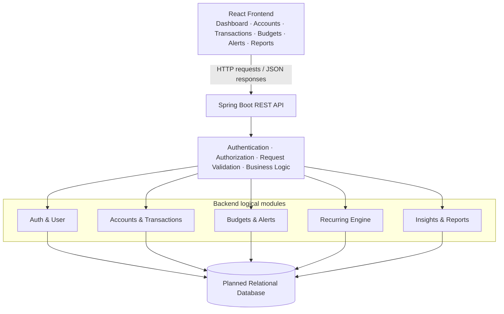

# Personal Expense & Budget Tracker

## Description
A personal finance application that allows users to manage income and expenses across multiple accounts, set monthly category budgets, receive overspending alerts, and view spending insights.

## Main Features
- Multiple accounts
- Income and expense management
- Monthly category budgets
- Overspending alerts
- Recurring transactions
- CSV import/export
- Spending charts and insights

## Project
This project is being developed as part of HCLTech Java Full Stack Training.

## Proposed Methodology
The project will be developed incrementally, following the training plan and validating each step before building on it:

1. **Requirement analysis:** review the project requirements, user needs, and non-functional requirements (NFRs) to define the scope and acceptance criteria.
2. **System and architectural design:** identify the application layers, logical modules, data entities, and API boundaries before implementation.
3. **Incremental implementation of functional modules:** implement and refine one feature area at a time, such as accounts and transactions, then budgets and alerts.
4. **Testing and validation:** check each module against its requirements, including error cases and relevant performance or data integrity criteria.
5. **Integration and version control:** integrate validated modules, resolve interface issues, and use Git to track the project history.
6. **Future enhancement according to the Master Daily Plan:** add the planned backend, persistence, security, frontend, and integration work as those topics occur in the training sequence.

This approach makes progress reviewable: each increment can be exercised and corrected before the next feature depends on it. The stages describe the proposed project workflow; they do not imply that every stage or feature is already complete.

## Requirements
The following are the JFS-20 requirements from the Project Catalog. They describe required behavior, not a claim that all behavior is implemented in the current application.

### Functional requirements

- **FR1:** User can create accounts with opening balances.
- **FR2:** User can add, edit, and delete transactions.
- **FR3:** System maintains running account balances.
- **FR4:** User can define recurring transactions.
- **FR5:** User can set category budgets per month.
- **FR6:** System alerts at 80% and 100% of budget.
- **FR7:** User can import transactions from CSV.
- **FR8:** User can view monthly trends and category charts.

The catalog also includes multiple accounts (cash, bank, card), transaction categories and tags, CSV export, and shared household budgets (invite member) in its feature description.

### Non-functional requirements

- **NFR-P1:** Users can access only their own data or data shared with them (ownership checks).
- **NFR-P2:** CSV import validates each row and reports errors without partial data corruption.
- **NFR-P3:** Dashboard response time is under one second for five years of data.
- **NFR-P4:** Use `BigDecimal` for monetary amounts.

These NFRs are requirements to verify as the full system is built; the current in-memory console application does not establish that access control, robust CSV import, or dashboard performance criteria are met.

## Proposed Methodology and Architectural Design
The complete application is proposed as a layered web system. The training plan covers relational database concepts, Spring Boot and REST APIs, security, and later React development. React and the web architecture below are planned design, not the current UI or runtime architecture.

### Presentation Layer
A planned React frontend will provide dashboard, account management, transactions, budgets, alerts, and reports screens. It will communicate with the backend using HTTP requests and JSON responses.

### Backend / Application Layer
The planned backend is a Java and Spring Boot REST application. It will handle requests, validate input, apply business rules, and enforce authentication and authorization. The functional areas below are logical backend modules; they are not independently deployed microservices in this proposal.

### Functional Modules

1. **Auth & User:** registration, login, roles, and access control.
2. **Accounts & Transactions:** account creation, income and expense entry, transaction create/read/update/delete operations, and running balances.
3. **Budgets & Alerts:** monthly category budgets and alerts at 80% and 100% of a budget.
4. **Recurring Engine:** recurring transaction rules and scheduled processing.
5. **Insights & Reports:** CSV import/export, monthly trends, and category charts.

### Data / Persistence Layer
The plan calls for relational database concepts and names the core entities for this project. The proposed schema will represent users, accounts, categories, transactions, tags and transaction-tag relationships, recurring rules, budgets, alerts, and household membership where applicable. Persistent database storage will preserve saved data across application restarts. The Master Daily Plan does not specify MySQL as a required project database; MySQL is one possible relational database option, mentioned in a later Docker exercise.

### Proposed Architecture Diagram

### Proposed Full-System Workflow Example
This is an example of the intended full web workflow; it does not claim that this complete frontend-to-database workflow already exists.

1. A user records a **₹2,000 food expense** against a **₹5,000 monthly food budget** in the React frontend.
2. The frontend submits the expense to the backend through an HTTP request with a JSON body.
3. The backend validates the request and applies authorization and transaction business rules.
4. The transaction is stored in the relational database.
5. The backend recalculates the current-month food budget total. At ₹2,000 spent, the total is 40% of the limit.
6. When monthly food spending reaches **₹4,000** (80% of ₹5,000), the 80% budget alert is triggered.
7. The backend returns the updated account balance and budget status to the frontend, which refreshes the dashboard.

## Technology Stack

| Component | Technology | Status |
|---|---|---|
| Frontend | React | Planned in the Master Daily Plan; not present in the current project tree |
| Backend | Java, Spring Boot | Java console application exists; Spring Boot REST application planned |
| API | REST, JSON | Planned; no REST API currently present |
| Database | Relational database | Planned; current data is held in memory |
| Database option | MySQL | Possible option, not a confirmed project requirement |
| Build | Maven | Currently used; `pom.xml` targets Java 21 |
| Version control | Git, GitHub | Git repository is present; GitHub hosting is not verified here |

## Current Implementation and Planned Full System

### Current implementation (verified from the project source)

- Java 21 console application with a menu-driven `Main` class.
- Maven build configuration.
- Object-oriented model and service classes, with Java Collections including `List`, `Set`, `Queue`, and `Map` in the in-memory service.
- `BigDecimal` for monetary amounts and calculations.
- Custom exceptions for invalid transaction amounts and insufficient funds, alongside argument validation.
- In-memory storage; application state is not persisted across restarts.
- Account creation with opening balances, transaction add/edit/delete, running balances, recurring rules and due processing, monthly category budgets, and 80%/100% threshold evaluation are implemented in the console application.
- CSV import, CSV export, authentication/authorization, shared household membership, dashboard charts, and a React/Spring web workflow are not implemented. The CSV and insights menu choices currently display selection messages only.

### Planned full-system features

- React frontend.
- Spring Boot REST API.
- Persistent relational database.
- Authentication and authorization, including access to owned or shared data.
- Validated CSV import/export.
- Charts and spending insights.

The requirements and proposed architecture above guide future development; they should not be read as completed functionality until the corresponding implementation and verification are in place.
